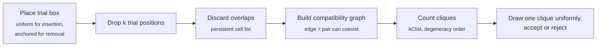
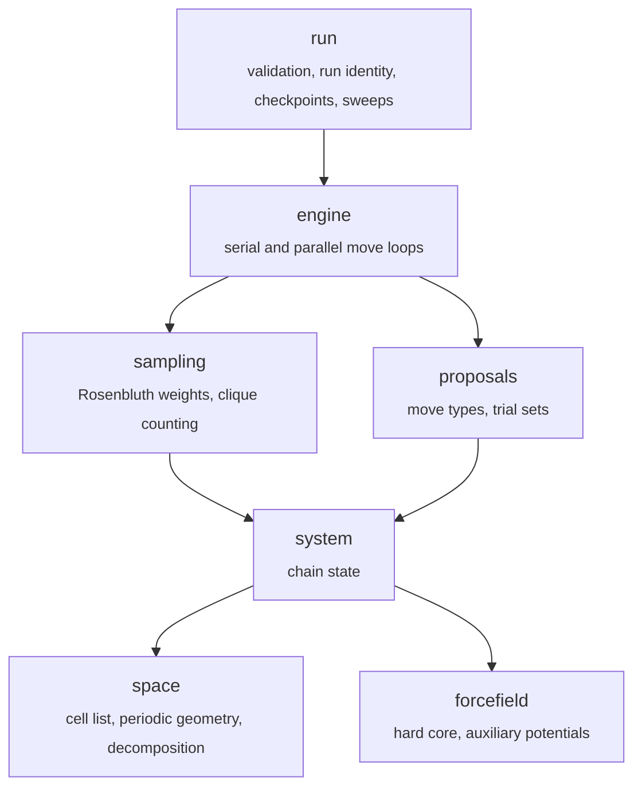

# BRANCH-MC

[](pyproject.toml)
[](LICENSE)
<!-- Add once CI is set up:
[](https://github.com/<user>/branch-mc/actions)
-->

**Grand-canonical Monte Carlo that keeps inserting particles where standard GCMC stalls.**

In a dense fluid almost every random insertion overlaps an existing particle, so
standard grand-canonical Monte Carlo (GCMC) effectively stops exchanging
particles. BRANCH-MC turns the insertion problem into a graph problem: it drops a
pool of trial positions into a small box, links every pair that can coexist, and
counts all valid arrangements as cliques of that graph. Instead of following one
random path through the possible arrangements, it evaluates all of them at once.

This repository is the reference implementation for:

> D. Somvanshi and C. J. Stein, *BRANCH-MC: Backtracking Recursive Algorithm for
> Navigating Configuration Hierarchies – Monte Carlo* (2026).

## Highlights

- **378× (2D) and 383× (3D) more accepted particle exchanges per CPU-second**
  than standard GCMC for dense hard disks and hard spheres.
- **Validated against the literature**: equations of state, number fluctuations, and quenched-annealed adsorption benchmarks.
- **Bit-reproducible runs**: a job killed at a walltime limit resumes as one continuous Markov chain, identical to an uninterrupted run.
- **Cost per move independent of system size**, through a persistent cell list and a local trial box.
- **Parallel by domain decomposition**, with the same statistics as a serial run.
- **One JSON file per run**: strictly validated.
- **Restart and run-lock**: Jobs lock once submitted so repeat jobs cannot overwrite data. 

---

## How one move works



An insertion empties the trial box and refills it with one more particle than it
held (*full repacking*); a removal refills it with one fewer. The acceptance
probability depends on the ratio of clique counts before and after, so every
possible refill contributes, not only the one that was proposed.

## How it's built

### Architecture



The package is split into layers, and each layer may only import from the
layers below it. The hierarchy is stored as data in a test
(`tests/unit/test_layer_ladder.py`), so adding a module without deciding where it
belongs, or introducing an upward import, fails the test suite.

### Configuration that fails fast

A run is described by one JSON file with five blocks: `potential`, `sampler`,
`engine`, `ensemble` and `run`. The validator turns it into a frozen, typed
configuration before anything runs, and it is strict:

- unknown keys are an error, so a typo cannot silently become different physics;
- keys that the chosen sampler does not read are an error too, rather than being
  ignored;
- every error names the key, what it conflicts with, and what to write instead.

`examples/schema.json` documents every key, and a test keeps it in sync with
the validator.

### Reproducible by construction

Each run directory is named by a hash of every setting that affects the physics.
Running the same file again resumes in place; two runs that differ in any
physical setting can never share a directory, and runs that differ only in
bookkeeping (for example how often they checkpoint) always do.

All randomness comes from a single PCG64 generator, which is checkpointed together
with the positions, the step counter and the move counters. A run that is killed
and resumed therefore produces exactly the same chain as one that was never
interrupted.

### Cost independent of system size

Every neighbour query in the move loop goes through one periodic cell list. It is
built once per sampling window and updated in constant time for each accepted
move, with its index stored in compressed sparse row form. Because every move acts
inside one small trial box, a move only touches the few cells around that box, so
the cost per move does not grow with the number of particles. The only work that
scales with system size is the once-per-window rebuild.

### Clique counting

The compatibility graph is small (only trial positions that do not overlap the
surroundings survive), and at liquid density it is sparse. Counting uses the
cheapest method for each clique size:

| Clique size | Method |
|---|---|
| 0–2 | closed form (1, node count, edge count) |
| 3 | one matrix product, `sum(A * (A @ A)) / 6` |
| 4 | vertex ordering by degree |
| ≥ 5 | kClist (Danisch et al., 2018) on a degeneracy ordering |

The move needs one configuration drawn uniformly from all cliques, which cannot
be listed and stored at this size. It is drawn by counting descent: the first
vertex is chosen in proportion to the number of cliques it owns, and the
procedure recurses into that vertex's neighbourhood.

### Parallel execution

The box is tiled into cells, one per core. Each cell runs an independent
grand-canonical chain on its own particles while a frozen border supplies its
neighbours; the gap between cells is wide enough that no two cells share an
interacting pair, so they can run concurrently without breaking detailed
balance. A new random grid origin is drawn every sampling window, so every region
is eventually sampled as the interior of a cell.

On an 80-core Intel Xeon Platinum 8380 node, strong scaling follows the ideal
line up to about 16 cores and reaches about 16× (relative to 4 cores) at 80 cores.
Under weak scaling, the cost per move stays at its single-core value up to 16
cores and roughly doubles at 80. The radial distribution function of a parallel
run matches the serial run and the analytic reference, including the contact
peak.

### Testing

The suite has four tiers:

| Tier | What it checks |
|---|---|
| Unit | geometry, cell list, clique counts against brute-force enumeration, configuration validation |
| Engine | equations of state, detailed balance, resume identity, serial–parallel agreement |
| Feature matrix | every supported combination of settings runs and matches a pinned digest |
| Characterisation | reference trajectories that must not change under refactoring |

---

## Benchmarks

Gains over standard GCMC at the optimum of each sampler (μ = 10 in 2D, μ = 12 in
3D). ESJD is the expected squared jump in particle number per exchange move, i.e.
the fraction of exchanges that are accepted.

| Sampler | ESJD, 2D | ESJD, 3D | ESJD/sec, 2D | ESJD/sec, 3D |
|---|---:|---:|---:|---:|
| Solvent repacking (SR) | 53× | 98× | 80× | 140× |
| SR with auxiliary potential | 142× | 139× | 138× | 154× |
| **BRANCH-MC** | **453×** | **917×** | **378×** | **383×** |

<!-- Add figures, e.g.


-->

The full parameter scans, equation-of-state checks and quenched-annealed
validation are in the paper.

---

## Installation

Requires Python 3.11 or newer. NumPy, SciPy and ASE are installed automatically.

```bash
git clone https://github.com/<user>/branch-mc.git
cd branch-mc
pip install -e .            # the package
pip install -e ".[dev]"     # plus pytest, ruff and mypy for development
```

## Quick start

Save this as `params.json`. It runs BRANCH-MC for 3D hard spheres at μ = 12
with the settings used in the paper:

```json
{
  "potential": { "main": "hard_core" },
  "sampler":   { "type": "branch", "trials": 389, "trial_box_side": 1.75 },
  "engine":    { "type": "metropolis_dynamics", "full_repacking": true },
  "ensemble":  { "type": "muVT", "mu": 12.0, "dimension": 3, "box": 20.0 },
  "run":       { "kind": "single", "sampling_window": 1000,
                 "target_cycles": 1000000, "seed": 1 }
}
```

```bash
python -m gcmc run params.json --root runs
```

This creates `runs/<hash>__mu12/` with the log, trajectory and checkpoint.
---

## Usage guide

### Units

Reduced units throughout: particle diameter σ = 1, β = 1 and thermal wavelength
Λ = σ. `mu` is the **total** chemical potential in units of k<sub>B</sub>T
(activity z = e<sup>βμ</sup>).

### Samplers

| `sampler.type` | Name in the paper | What it does |
|---|---|---|
| `metropolis` | Standard GCMC | single-particle insertion, removal and translation |
| `rosenbluth` | Solvent repacking (SR) | repacks the trial box by sequential configuration-bias selection |
| `rosenbluth` + `auxiliary` | SR with auxiliary potential | as SR, with trial selection biased by the fluid's own structure |
| `branch` | BRANCH-MC | repacks the trial box by counting and sampling cliques |

All samplers use the same move mix: 50% translation, 25% insertion, 25% removal.

### Trial box and full repacking

`rosenbluth` and `branch` act on a cubic (square in 2D) trial box of side
`sampler.trial_box_side`, filled with `sampler.trials` trial positions (or give
`sampler.trial_density` instead). With `engine.full_repacking: true`, every
exchange empties the box and refills it: one particle more for an insertion, one
fewer for a removal. An insertion into an empty box falls back to a plain
single-particle insertion.

Settings used in the paper:

| | 2D (μ = 10) | 3D (μ = 12) |
|---|---|---|
| BRANCH-MC | L ≈ 1.8 σ, 200 trials | L = 1.75 σ, 389 trials |

### Auxiliary potential

For SR, trial selection can be biased toward the structure of the dense fluid.
The bias is divided back out in the acceptance, so the sampled ensemble is
unchanged; only the efficiency improves.

- **2D:** the hard-disk radial distribution function at packing fraction 0.69,
  from Liu's equation of state, truncated at 3.7545 σ.
- **3D:** a tabulated radial–angular distribution g<sub>3</sub>(r, cos θ),
  truncated at 1.8 σ. The table used in the paper is `data/g3_analysis_data.csv`.

```json
"auxiliary": { "type": "pmf", "gamma": 0.55 }
```
```json
"auxiliary": { "type": "pmf", "gamma": 0.8, "g3_csv": "/abs/path/data/g3_analysis_data.csv" }
```

`gamma` damps the bias; 0.55 (2D) and 0.8 (3D) were optimal in the paper. BRANCH-MC
does not use an auxiliary potential: for a hard core, every valid configuration
carries the same weight.

### Sweeps

Give any sweepable key as a list, and the launcher runs one simulation per value
(the Cartesian product if several keys are lists):

```json
"ensemble": { "mu": [8.0, 9.0, 10.0, 11.0], "dimension": 2, "box": 75.0 }
```

```bash
python -m gcmc.run.launcher base.json --cores 16 --root runs
```

Sweepable keys include `ensemble.mu`, `ensemble.packing_fraction`, `ensemble.N`,
`sampler.trials`, `sampler.trial_density` and `sampler.trial_box_side`. The
launcher refuses to start if the sweep needs more cores than `--cores`, and never
runs more jobs at once than fit.

### Parallel runs

```json
"ensemble": { "mu": 15.0, "dimension": 3, "box": [50, 40, 40] },
"run":      { "kind": "parallel", "n_cell": [5, 4, 4] }
```

One cell is one core, so `n_cell` is also the core count. Cell sizes and the
frozen border are derived automatically; a cell count the box cannot take is an
error that lists the nearest counts that work.

### Quenched-annealed fluids

A quenched-annealed run is a fluid at fixed μ inside a frozen, disordered matrix
of obstacles. The matrix only enters the overlap test: it is never inserted,
removed, moved or counted. It takes two steps:

1. **Generate a matrix** with an NVT run at the target matrix packing fraction:

   ```json
   {
     "potential": { "main": "hard_core" },
     "sampler":   { "type": "metropolis" },
     "ensemble":  { "type": "NVT", "packing_fraction": 0.157, "dimension": 3, "box": 9.4 }
   }
   ```

2. **Run the fluid** in that matrix, pointing `matrix_config` at the matrix run's
   `checkpoint.npz`:

   ```json
   {
     "potential": { "main": "hard_core" },
     "sampler":   { "type": "branch", "trials": 389, "trial_box_side": 1.75 },
     "engine":    { "type": "metropolis_dynamics", "full_repacking": true },
     "ensemble":  { "type": "QA", "mu": [-4.0, 0.0, 4.0, 8.0], "dimension": 3, "box": 9.4 },
     "run":       { "kind": "single",
                    "matrix_config": "/abs/path/to/matrix_run/checkpoint.npz" }
   }
   ```

The matrix content is part of the run hash, so each matrix realisation gets its
own directory. Average observables over several realisations (the paper uses 16).
Quenched-annealed runs are serial only.

### Output files

Each run directory contains:

| File | Contents |
|---|---|
| `params.json` | the exact inputs used |
| `run.log` | one row per sampling window: packing fraction, N, accepted and attempted moves, wall time |
| `trajectory.extxyz` | configurations (extended XYZ; the last frame only unless `run.traj_every` is set) |
| `checkpoint.npz` | positions, counters and RNG state; the only file read on resume |


## Repository layout

```
gcmc/
  forcefield/   hard-core potential and auxiliary potentials
  space/        periodic geometry, cell list, domain decomposition
  system/       chain state
  proposals/    move types and trial sets
  sampling/     Rosenbluth weights and clique counting
  engine/       serial and parallel move loops
  run/          validation, run identity, checkpointing, sweep launcher
  analysis/     g(r) and other post-processing
examples/       annotated schema and example inputs
data/           g3 table for the 3D auxiliary potential
tests/          unit, engine, feature-matrix and characterisation tests
images/         figures from the paper
```

## Citation

If you use this code, please cite the paper:

```bibtex
@article{somvanshi2026branchmc,
  title   = {{BRANCH-MC}: Backtracking Recursive Algorithm for Navigating
             Configuration Hierarchies -- Monte Carlo},
  author  = {Somvanshi, Dipesh and Stein, Christopher J.},
  journal = {<journal>},
  year    = {2026},
  doi     = {<doi>}
}
```

## License

MIT. See [LICENSE](LICENSE).
